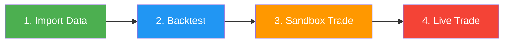

# 📋 Modes

Gekko 2 operates in three distinct modes, each designed for a specific stage of your trading workflow. Understanding these modes is essential for effectively developing, testing, and deploying your trading strategies.

---

## Overview

| Mode         | Purpose                              | Data Source     | Execution Speed | Risk Level |
|--------------|--------------------------------------|-----------------|-----------------|------------|
| **Importer** | Collect historical market data       | Live exchange   | API-limited     | None       |
| **Backtest** | Simulate strategies on past data     | Local database  | Ultra-fast      | None       |
| **Realtime** | Live market monitoring and trading   | Live exchange   | Real-time       | Variable   |

---

## 📥 Importer Mode

**Purpose:** Fetch and store historical candle data from cryptocurrency exchanges into a local database.

### When to Use

- Before running backtests (backtesting requires historical data)
- To update your local data with the latest market information
- When switching to a new trading pair or exchange
- To fill gaps in your existing data

### How It Works

1. Gekko connects to the specified exchange's public API
2. Requests the 1-minute candles of each watched pair over `watch.daterange`
3. Downloads them page by page, each pair at most one request every `tickrate` ms (respecting API rate limits)
4. Stores data in the local SQLite database for future use

### Configuration

```yaml
watch:
  assets: [BTC]
  currency: USDT
  mode: importer
  tickrate: 500              # Milliseconds between API requests (rate limiting)
  daterange:
    start: '2024-01-01T00:00:00.000Z'
    end: '2024-12-01T00:00:00.000Z'

exchange:
  name: binance              # Exchange to fetch data from

storage:
  type: sqlite
  database: ./db/binance-BTC_USDT.sql
  # insertThreshold: 1000    # Optional: minutes of candles buffered before each write

plugins:
  - name: CandleWriter       # Required: saves candles to database
```

### Key Configuration Options

| Option                    | Description                                                      | Example Values                                                                           |
|---------------------------|------------------------------------------------------------------|------------------------------------------------------------------------------------------|
| `assets`                  | The base assets to import, in upper case                         | `[BTC, ETH, SOL]`                                                                        |
| `currency`                | The quote currency, in upper case                                | `USDT`, `EUR`, `BTC`                                                                     |
| `tickrate`                | Least delay between two requests of a pair (ms), at least `100`  | `500` (recommended); default `1000`                                                      |
| `daterange.start`         | First minute of the range, included                              | `2024-01-01` (its midnight UTC), `'2024-01-01T00:00:00Z'`, `'2024-01-01T02:00:00+02:00'` |
| `daterange.end`           | Last minute of the range, included (equal bounds are one minute) | The same forms                                                                           |
| `storage.insertThreshold` | Optional: minutes of candles buffered before each write          | `1` to `1440` (a day); default `1000`, `1` in realtime                                   |

A `daterange` bound is a day, read as its midnight UTC, or a day and a time with `Z` or an offset, quoted or not: `end: 2024-12-31` reads only the first minute of December 31st, `2024-12-31T23:59:00Z` the whole day. A day that does not exist (`2023-02-29`), a time without `Z` or an offset, and a range that ends before the minute it starts in are refused at start-up. Write assets and the currency as the exchange lists them, in upper case (`BTC`, `1INCH`): `btc` is refused.

### Important Notes

> [!IMPORTANT]
> The `CandleWriter` plugin is **required** for importer mode. Without it, fetched data will not be saved.

> [!NOTE]
> An import asks the exchange for one page of candles per pair at most every `tickrate` ms, the pairs side by side, and a Binance page holds 1000 minutes: a year takes at least 4.4 minutes at `tickrate: 500` (526 pages a pair) and 8.8 minutes at the default of 1000 ms, and `config/importer.yml` (October 2017 to January 2026, `tickrate: 500`) at least 36 minutes (4341 pages a pair). An exchange slower to answer than `tickrate` takes longer.

> [!NOTE]
> An import replaces whatever the database already holds for the minutes the exchange returns, a minute without trades included; the candle it makes up for a minute the exchange lacks only replaces a stored candle that is made up too. A realtime run with `CandleWriter` only replaces a stored made-up candle, and only with a candle that traded. Re-importing therefore repairs the flat, zero-volume candles that a realtime run stores for the minutes it missed: re-import the ranges named by its `Total gap detected` and `Partial gap` warnings.

> [!NOTE]
> A minute the exchange lacks is filled with a flat, zero-volume candle at the last close, for a gap of up to 7 days, whether one pair is missing while the others trade or every pair is. A longer gap in a pair's history is not filled: the import stops with an error naming the pair and the gap before writing any of it, and the ranges before and after the gap can be imported apart. A pair whose history ends before the range does (delisted, or without candles for the last minutes of the range although the exchange has later ones) is not filled either: the other pairs are imported to the end, that pair's last minutes stay missing, with a warning saying how many, and a backtest of them is refused rather than run on made-up prices. A realtime run fills the gaps of its warmup history the same way, and fills a pair whose history ends early until its live candles start.

> [!NOTE]
> On `hyperliquid` (importer or realtime), write a Unit-wrapped spot token by its token name in `watch.assets` (`UBTC`, `UETH`, `USOL`, `UPUMP`...), not by the coin it wraps: ccxt resolves the token name to its spot market, while a coin name only works when ccxt happens to name the market after it (`BTC/USDC` resolves, `PUMP/USDC` does not).

An import from `hyperliquid` needs no key: its `exchange` section is the name alone, with `watch` naming a Hyperliquid spot market (`assets: [UBTC]`, `currency: USDC`):

```yaml
exchange:
  name: hyperliquid              # No key: an import reads the markets and the candles through the public API
```

### Required Plugin

- **CandleWriter** — Saves imported candles to the configured database

---

## 📊 Backtest Mode

**Purpose:** Simulate trading strategies on historical data to evaluate performance without risking real money.

### When to Use

- Testing new strategy ideas
- Optimizing strategy parameters
- Comparing different strategies on the same data
- Validating strategy behavior before live deployment
- Analyzing performance metrics (profit/loss, drawdown, Sharpe ratio)

### How It Works

1. Gekko loads historical candles from the local database
2. Replays market data at high speed through your strategy
3. Simulates order execution via the `dummy-cex` exchange
4. Calculates comprehensive performance metrics
5. Outputs trade history and statistics

### Configuration

```yaml
watch:
  assets: [BTC]
  currency: USDT
  mode: backtest
  timeframe: 1h              # Candle timeframe for strategy
  warmup:
    candleCount: 365         # Candles needed before trading starts
  daterange:
    start: '2024-01-01T00:00:00.000Z'
    end: '2024-12-01T00:00:00.000Z'

exchange:
  name: dummy-cex            # Simulated exchange for backtesting
  marketData:                # Fees and order limits, one entry per watched pair
    - symbol: BTC/USDT
      marketData:
        price:
          min: 0.01
          max: 1000000
        amount:
          min: 0.00001
          max: 9000
        cost:
          min: 5
          max: 9000000
        precision:           # Decimals of a price and of an amount, a whole number (8 = steps of 0.00000001), not a step like 0.01
          price: 8
          amount: 8
        fee:
          maker: 0.0004
          taker: 0.0007
  simulationBalance:         # Starting balances: the watched assets and the currency only, each once
    - assetName: BTC
      balance: 0
    - assetName: USDT
      balance: 1000

storage:
  type: sqlite
  database: ./db/binance-BTC_USDT.sql

strategy:
  name: RSI
  src: ohlc4                 # Price source: open, high, low, close, hl2, hlc3 or ohlc4
  period: 21
  thresholds:
    high: 70
    low: 30
    persistence: 0

plugins:
  - name: TradingAdvisor     # Runs strategy and generates signals
    strategyName: RSI

  - name: Trader             # Executes simulated orders

  - name: RoundTripAnalyzer
    enableConsoleTable: true # Display results in terminal table
```

The simulator receives each order as the live exchange does: its amount truncated to the amount step (`precision.amount`), its price rounded half up to the price tick (`precision.price`). An amount truncated to 0, or whose cost falls under `cost.min`, is refused, and an order fills for the amount truncated. The cost is worked out in decimal, as the exchange works it out: an order costing exactly `cost.min` passes. For Hyperliquid, whose tick depends on the price, add `priceSignificantDigits: 5` under `precision`.

Write assets, the currency and symbols in upper case, as the exchange lists them (`BTC`, `1INCH`, `BTC/USDT`). Each `marketData` symbol, and each `initialTicker` one, appears once. `simulationBalance` lists only the watched assets and the currency, each once and spelt as in `watch`: a balance of any other asset (`usdt`, an asset not watched) is refused, the simulator never holding it.

### Key Configuration Options

| Option               | Description                                         | Example Values                      |
|----------------------|-----------------------------------------------------|-------------------------------------|
| `timeframe`          | Candle period for strategy                          | `1m`, `5m`, `15m`, `1h`, `4h`, `1d` |
| `warmup.candleCount` | Candles before trading                              | `100`, `365`, `1000`                |
| `exchange.name`      | Must be `dummy-cex`                                 | `dummy-cex`                         |
| `strategyName`       | TradingAdvisor option: the strategy to backtest     | `RSI`, `DEMA`, `GridBot`, etc.      |
| `strategy.name`      | Must equal `strategyName`: it only labels the run   | The same as `strategyName`          |

### Important Notes

> [!IMPORTANT]
> Always use `dummy-cex` as the exchange for backtesting. This simulated exchange handles order execution without real API calls.

> [!TIP]
> Set `warmup.candleCount` from what your strategy's indicators need: an indicator whose first complete value comes at candle K has it on the first candle after the warmup when `candleCount` is K − 1 or more, and K depends on the indicator, not only on its period. Of the 200-period moving averages, an SMA, EMA or WMA needs 199, a DEMA 398 and a TEMA 597: see [Set Adequate Warmup](./custom-strategies.md#5-set-adequate-warmup) for each indicator. The strategy trades from the candle after the warmup, so `watch.daterange` must hold more whole `timeframe` candles than `warmup.candleCount`, counted from the first timeframe boundary at or after its start (in UTC: a `1w` candle starts on a Monday, a `1M` candle on the 1st); otherwise Gekko refuses the configuration.

> [!NOTE]
> Backtesting runs at maximum speed — years of data can be processed in seconds.

### Typical Plugins

| Plugin                  | Purpose                                             |
|-------------------------|-----------------------------------------------------|
| **TradingAdvisor**      | Runs your strategy and generates buy/sell signals   |
| **Trader**              | Executes orders on the dummy exchange               |
| **RoundTripAnalyzer**   | Calculates returns, win rate, Sharpe ratio, etc.    |

### Performance Metrics

The analyzers provide (configure `RoundTripAnalyzer` or `PortfolioAnalyzer`, not both):
- **Total Return** — Overall profit/loss percentage
- **Max Drawdown** — Largest peak-to-trough decline (`PortfolioAnalyzer`)
- **Longest Drawdown** — Duration of the longest drawdown period (`PortfolioAnalyzer`)
- **Sharpe Ratio** — Risk-adjusted return
- **Win Rate** — Percentage of profitable trades (`RoundTripAnalyzer`)
- **Trade Count** — Total number of executed trades (`RoundTripAnalyzer`)

---

## 🔴 Realtime Mode

**Purpose:** Connect to live markets for real-time monitoring, alerts, paper trading, or live automated trading.

### When to Use

- Monitoring markets for trading signals (screener)
- Paper trading with exchange testnets (sandbox)
- Live trading with real funds
- Automated portfolio supervision and alerts

### How It Works

1. Gekko downloads the warmup history from the exchange's REST API: the `warmup.candleCount` timeframe candles before the one in progress, and the minutes of that one that have closed
2. Then, two seconds after each minute boundary, it asks the REST API for the minutes that closed since the last one it received. There is no WebSocket: a minute is read once it has closed, never while it forms, and a pair that delivers no candle for 5 minutes stops the run
3. Builds each timeframe candle from those minutes and runs your strategy on it once it is complete
4. Optionally executes orders based on strategy signals
5. Sends notifications via Telegram (if configured)

### Use Cases

Realtime mode supports several use cases depending on your plugin configuration:

#### 1. Screener (Alerts Only)

Monitor markets and receive Telegram alerts when your strategy emits signals.

```yaml
watch:
  assets: [BTC]
  currency: USDT
  mode: realtime
  timeframe: 4h
  warmup:
    candleCount: 365

# It will simulate authenticated calls to the exchange (place orders, cancel orders, fetchBalance, etc.) 
# and use real unauthenticated data (fetchCandles, etc.)
exchange:
  name: paper-binance
  simulationBalance:             # Simulated balances, required by paper-binance: the watched assets and the currency only
    - assetName: BTC
      balance: 1
    - assetName: USDT
      balance: 10000

strategy:
  name: RSI
  period: 21
  thresholds:
    high: 70
    low: 30
    persistence: 0

plugins:
  - name: TradingAdvisor
    strategyName: RSI

  - name: Trader                 # Simulates the orders, whose end the strategy waits for (see below)

  - name: EventSubscriber        # Telegram alerts
    token: YOUR_BOT_TOKEN
    botUsername: YOUR_BOT_USERNAME
    # chatId: 123456789 # Optional: the chat the bot talks to; without it, the first chat that sends it a command after start-up is bound
```

> [!IMPORTANT]
> Keep the `Trader`, even for alerts: it is the only plugin that executes the orders the strategy creates, and every built-in strategy waits for its order to end (completed, canceled or errored) before it advises again. Without a Trader, the first order never ends, the strategy advises once per run, and Gekko warns at start-up (`warn` level, so set `GEKKO_LOG_LEVEL` to `warn` or `info` to see it). On `paper-binance` the orders are only simulated, from `simulationBalance`. `hyperliquid` has no paper exchange: there, the Trader places the orders on the account, or on its testnet with `sandbox: true`.

The alerts are the strategy's orders (`/sub_strat_create`) and its log lines at the `info`, `warn` and `error` levels (`/sub_strat_info`), the error line that stops the bot included; its `debug` lines are not sent.

Once Gekko runs, send the bot `/subscribe_all`, and again after every restart: the EventSubscriber sends nothing until its chat subscribes. `/sub_strat_create` and `/sub_strat_info` subscribe to these alerts alone (each `/sub_…` command toggles its subscription, and `/help` lists them). The subscriptions are kept in memory only, so a restart forgets them; with `chatId` set, a command your chat sent the bot while Gekko was not running is handled as it starts.

#### 2. Sandbox Trading (Paper Money)

Test strategies with fake money on exchange testnets. Real orders are placed, but with virtual funds.

```yaml
watch:
  assets: [BTC]
  currency: USDT
  mode: realtime
  timeframe: 1d
  warmup:
    candleCount: 365

exchange:
  name: binance
  sandbox: true                  # Use testnet
  apiKey: YOUR_SANDBOX_API_KEY
  secret: YOUR_SANDBOX_API_SECRET

strategy:
  name: DEMA
  period: 12
  thresholds:
    up: 100
    down: -150

plugins:
  - name: TradingAdvisor
    strategyName: DEMA

  - name: Trader                 # Executes orders on sandbox

  - name: RoundTripAnalyzer
    riskFreeReturn: 5
```

> [!TIP]
> Get Binance testnet API keys at: https://testnet.binance.vision/

#### 3. Paper Trading (Local Simulation)

Trade with simulated money using **real market data** from Binance, but with orders executed locally. No API keys required for trading.

```yaml
watch:
  assets: [BTC]
  currency: USDT
  mode: realtime
  timeframe: 1h
  warmup:
    candleCount: 365

exchange:
  name: paper-binance            # Uses real Binance data, simulates orders locally
  simulationBalance:
    - assetName: BTC
      balance: 1                 # Starting BTC balance
    - assetName: USDT
      balance: 10000             # Starting USDT balance
  # feeOverride:                 # Optional: override exchange fees
  #   maker: 0.001
  #   taker: 0.002

strategy:
  name: DEMA
  period: 12
  thresholds:
    up: 100
    down: -150

plugins:
  - name: TradingAdvisor
    strategyName: DEMA

  - name: Trader

  - name: RoundTripAnalyzer
    enableConsoleTable: true
```

`simulationBalance` lists only the watched assets and the currency, each once and spelt as in `watch`: a balance of any other asset is refused, the simulator never holding it, and a watched one left out starts at 0. At start-up Gekko logs the portfolio the simulator starts with, at the `info` level: `Initial portfolio: 1 BTC, 10,000 USDT`.

| Feature              | Sandbox (`sandbox: true`)       | Paper Trading (`paper-binance`) |
|----------------------|---------------------------------|---------------------------------|
| Market data source   | Binance Testnet                 | Binance Mainnet (real prices)   |
| Order execution      | Real orders on testnet          | Simulated locally               |
| API keys required    | ✅ Testnet keys                 | ❌ Not required                 |
| Network dependency   | Requires testnet availability   | Only needs price feed           |
| Best for             | Testing order execution logic   | Quick strategy iteration        |

> [!TIP]
> Use `paper-binance` for rapid strategy testing with real market conditions. Switch to `sandbox` when you need to test actual order execution and API integration.

#### 4. Live Trading (Real Money)

> [!CAUTION]
> **REAL MONEY AT RISK.** Only use live trading if you fully understand the risks and have thoroughly tested your strategy via backtesting and sandbox trading.

```yaml
watch:
  assets: [BTC]
  currency: USDT
  mode: realtime
  timeframe: 1h
  warmup:
    candleCount: 365

exchange:
  name: binance
  apiKey: YOUR_LIVE_API_KEY
  secret: YOUR_LIVE_API_SECRET

strategy:
  name: DEMA
  period: 12
  thresholds:
    up: 100
    down: -150

plugins:
  - name: TradingAdvisor
    strategyName: DEMA

  - name: Trader

  - name: RoundTripAnalyzer
    riskFreeReturn: 5

  - name: EventSubscriber        # Telegram notifications, once the chat subscribes (see the screener above)
    token: YOUR_BOT_TOKEN
    botUsername: YOUR_BOT_USERNAME
    # chatId: 123456789 # Optional: the chat the bot talks to; without it, the first chat that sends it a command after start-up is bound

'I understand that Gekko only automates MY OWN trading strategies': true
```

> [!NOTE]
> An exchange takes a limited amount in one order: on Binance, a `MARKET` order is held to MARKET_LOT_SIZE, tens of BTC on BTC/USDT, far below what `LIMIT` and `STICKY` orders can buy. The Trader caps a SELL, and an all-in BUY, at that maximum with a warning (`… above the maximum amount of a MARKET order on BTC/USDT: … sent, the rest stays held`), and the rest waits for a later order (see the Trader's [Sizing](./plugins.md#sizing)).

On `hyperliquid`, the `exchange` section holds the address of the account and the key that signs its orders, both in quotes, and `watch` names a Hyperliquid spot market (`assets: [UBTC]`, `currency: USDC`: see the note on Unit-wrapped tokens under [Importer Mode](#-importer-mode)):

```yaml
exchange:
  name: hyperliquid
  walletAddress: '0x…'           # In quotes: the address of the account Gekko reads and trades for
  privateKey: '0x…'              # In quotes: the private key that signs that account's orders
  # sandbox: true                # Optional: Hyperliquid's testnet
```

Both keys are optional, and the plugins decide which a run needs. An import needs neither, nor does a realtime run without a TradingAdvisor or a Trader (a `CandleWriter`, `Supervision`). A TradingAdvisor needs `walletAddress`, even without a Trader, since it reads the account's open orders and balance at start-up. A Trader needs both. Gekko refuses at start-up a realtime configuration whose TradingAdvisor lacks `walletAddress`, or whose Trader lacks either key, and in any mode a `privateKey` given without `walletAddress`.

- `walletAddress` is the public address of the account whose balance and orders Gekko reads.
- `privateKey` signs that account's orders. Gekko does not work the address out from the key, nor check that the two belong together: give the address of the account the key trades for.
- Write both in quotes: unquoted, YAML reads `0x…` as a hexadecimal number, which Gekko refuses (`privateKey must be written in quotes ('0x…')`).
- Gekko creates the Hyperliquid client with ccxt's builder fee turned off. Otherwise ccxt would sign, before the first order or cancelation of a run, the approval of a fee of up to 0.01 % for ccxt's own address, and attach that fee to every order.

#### 5. Supervision Mode

Monitor your bot's health with Telegram commands and receive system alerts.

```yaml
plugins:
  - name: Supervision
    token: YOUR_BOT_TOKEN
    botUsername: YOUR_BOT_USERNAME
    # chatId: 123456789 # Optional: the chat the bot talks to; without it, the first chat that sends it a command after start-up is bound
    cpuThreshold: 80             # Once subscribed (/sub_cpu_check): alert if CPU > 80%
    memoryThreshold: 1024        # Once subscribed (/sub_memory_check): alert if memory > 1024 MB
    cpuCheckInterval: 10000      # Check every 10 seconds
    memoryCheckInterval: 10000
```

Supervision starts subscribed to nothing, and runs no check, so sends no alert, until its chat subscribes. Once Gekko runs, send the bot `/subscribe_all`, or the command of each check you want (`/sub_cpu_check`, `/sub_memory_check`, `/sub_candle_check`, `/sub_monitor_log`), which toggles it, and again after every restart: the subscriptions are kept in memory only. Until a check is subscribed to, its threshold and interval in the block only configure it; `/healthcheck` answers without a subscription. Beside an EventSubscriber, Supervision needs a bot of its own, with its own token (see [Realtime Trading](./plugins.md#realtime-trading) in the plugins guide), and each bot sends nothing until the chat subscribes to it.

### Key Configuration Options

| Option                   | Description                                                          | Values                              |
|--------------------------|----------------------------------------------------------------------|-------------------------------------|
| `exchange.sandbox`       | `binance`, `hyperliquid`: use the testnet instead of mainnet         | `true`, `false` (default)           |
| `exchange.apiKey`        | `binance`: API key for authenticated requests                        | Your API key                        |
| `exchange.secret`        | `binance`: API secret for signing requests                           | Your API secret                     |
| `exchange.walletAddress` | `hyperliquid`: the address of the account Gekko reads and trades for | `'0x…'`, in quotes                  |
| `exchange.privateKey`    | `hyperliquid`: the private key that signs that account's orders      | `'0x…'`, in quotes                  |
| `timeframe`              | Live candle period                                                   | `1m`, `5m`, `15m`, `1h`, `4h`, `1d` |

### Important Notes

> [!WARNING]
> The line `'I understand that Gekko only automates MY OWN trading strategies': true`, at the top level of the file, outside every section, is **required** for any configuration that runs a `Trader` on a real exchange (`binance` or `hyperliquid` without `sandbox: true`), where orders spend real money: Gekko refuses to start without it. This confirms you understand that Gekko automates your strategy — it does not provide trading advice. Sandbox (`sandbox: true`), `paper-binance` and `dummy-cex` configurations do not need it.

> [!IMPORTANT]
> Gekko reads your keys from the configuration file only. The only environment variables it reads are `GEKKO_CONFIG_FILE_PATH` and `GEKKO_LOG_LEVEL`, and it expands none written in the file: `apiKey: ${BINANCE_API_KEY}` is read as that text. Never write your keys into the tracked files of `config/`, which `git commit -a` would commit. Copy the example instead (`cp config/realtime-trader.yml config/realtime-trader.local.yml`), write your keys into the copy, and run it with `GEKKO_CONFIG_FILE_PATH=config/realtime-trader.local.yml`: git ignores every `config/*.local.*` file (`.yml`, `.yaml`, `.json` or `.json5`). Never share that file or your keys.

### Available Plugins for Realtime

| Plugin                  | Description                                                                     |
|-------------------------|---------------------------------------------------------------------------------|
| **TradingAdvisor**      | Runs strategy and generates signals                                             |
| **Trader**              | Executes orders on the exchange                                                 |
| **RoundTripAnalyzer**   | Logs each round trip as it closes, and reports on the run when it ends          |
| **PortfolioAnalyzer**   | Measures performance from the portfolio's value, and reports when the run ends  |
| **CandleWriter**        | Saves the live candles to the database (needs `storage`)                        |
| **EventSubscriber**     | Sends trading events to Telegram                                                |
| **Supervision**         | System monitoring and Telegram bot commands                                     |

Configure `RoundTripAnalyzer` or `PortfolioAnalyzer`, not both: both emit the performance report. A realtime run never ends by itself, so that report comes only when an error or the circuit breaker stops the run. Ctrl-C (SIGINT), like SIGTERM, ends it at once without finalising the plugins, and so without the report. The round trips are not lost: the RoundTripAnalyzer logs each one as it closes (at the `info` level, and as a table with `enableConsoleTable`), and the EventSubscriber relays it (`/sub_roundtrip_complete`).

---

## Mode Comparison

| Feature               | Importer                 | Backtest     | Realtime                                  |
|-----------------------|--------------------------|--------------|-------------------------------------------|
| Requires internet     | ✅ Yes                   | ❌ No        | ✅ Yes                                    |
| Requires database     | ✅ Yes                   | ✅ Yes       | ❌ Optional                               |
| Required exchange     | `binance`, `hyperliquid` | `dummy-cex`  | `binance`, `hyperliquid`, `paper-binance` |
| API keys needed       | ❌ No                    | ❌ No        | 🔶 With a TradingAdvisor or a Trader      |
| Strategy required     | ❌ No                    | ✅ Yes       | 🔶 For signals and trades                 |
| Executes trades       | ❌ No                    | ✅ Simulated | 🔶 Configurable                           |
| Speed                 | API-limited              | Ultra-fast   | Real-time                                 |
| Risk                  | None                     | None         | Low to High                               |

In realtime, a TradingAdvisor reads the account's open orders and balance from the exchange at start-up, even without a Trader, and the Trader reads the balance and places the orders. On `binance` they need `apiKey` and `secret`, testnet keys with `sandbox: true`. Binance's keys are not checked by plugin: a run without them fails at its first read, the TradingAdvisor's at start-up, on ccxt's `AuthenticationError: binance requires "apiKey" credential`. On `hyperliquid`, a TradingAdvisor or a Trader needs `walletAddress`, and a Trader `privateKey` too: Gekko refuses a realtime configuration without them at start-up (see [Live Trading](#4-live-trading-real-money)). `paper-binance` needs no key. Nor does a realtime run without a TradingAdvisor or a Trader, which needs no strategy either: a `CandleWriter` recording the live candles, as `config/realtime-writer.yml` does, or `Supervision` alone.

---

## Workflow Recommendation

For the safest and most effective workflow, follow these steps:



1. **Import** historical data for your trading pair
2. **Backtest** your strategy to validate performance
3. **Sandbox trade** on a testnet to verify execution behavior
4. **Live trade** only after thorough testing and understanding of risks
